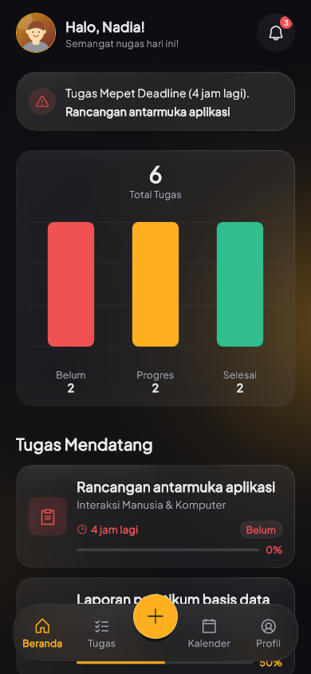
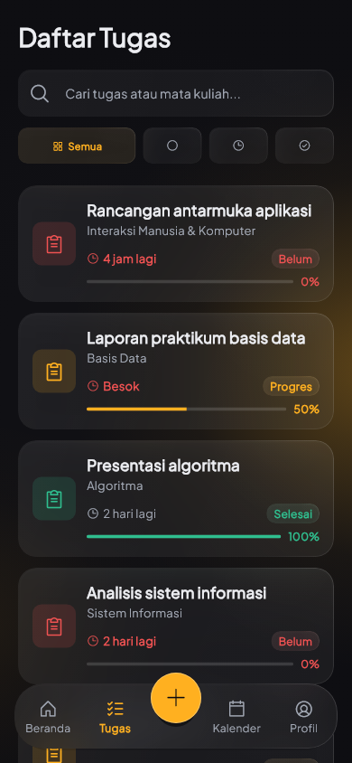
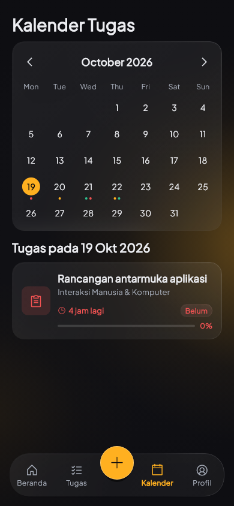
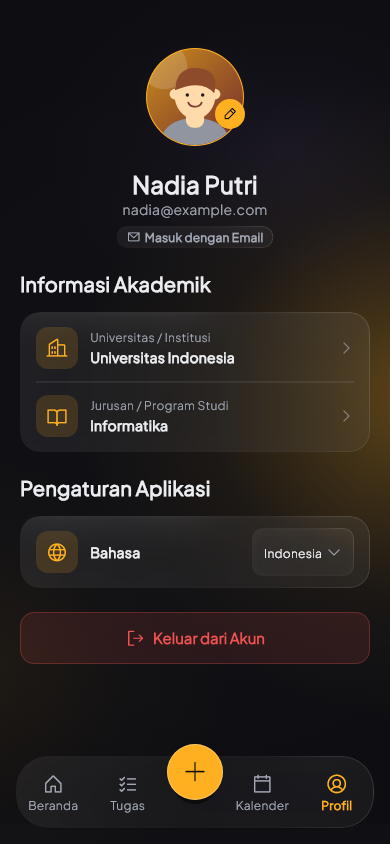

<p align="center">
  
</p>

<h1 align="center">Takumi</h1>

<p align="center">A distraction-free coursework and deadline planner for Android.</p>

<p align="center">
  <a href="https://www.android.com/"></a>
  <a href="https://flutter.dev/"></a>
  <a href="https://dart.dev/"></a>
  <a href="pubspec.yaml"></a>
  <a href="https://github.com/muhamaddikrulloh/takumi/actions/workflows/ci.yml"></a>
  <a href="LICENSE"></a>
</p>

Takumi is an open-source Android app built with Flutter to help students organize assignments, track academic deadlines, and schedule reminders in one unified place.

---

## Overview

Balancing assignments across different courses often leads to forgotten deadlines and scattered notes. Takumi provides a dedicated mobile workspace to track academic priorities with a dark glass theme:

- **Focused Task Tracking**: Organize coursework with deadline dates, status tags, and priority levels.
- **Calendar Visualization**: View upcoming due dates on a monthly calendar grid with daily task listings.
- **Offline Caching**: Tasks and profile data are cached locally on device via Cloud Firestore offline persistence, queuing writes until network connectivity is restored.
- **Scheduled Notifications**: Multi-interval reminder alerts before each assignment deadline, using Android exact alarms when permitted.

## Features

- **Authentication & Security**: Email/password registration with email verification, Google Sign-In, and password reset protected by a progressive client-side cooldown (up to 5 requests per hour).
- **Coursework Management**: Create, edit, search, filter (by status and priority), and mark assignments as completed.
- **Deadline Calendar**: Interactive calendar view highlighting due dates, with instant filtering for selected days.
- **Multi-Stage Reminders**: Local reminder alerts scheduled at 72h, 24h, 12h, and 3h before a deadline, plus at the due time. Exact alarm scheduling is requested when supported, falling back to standard scheduling based on device power management and Android permissions.
- **Offline Persistence**: Cloud Firestore cache (up to 100 MB local cache) allows browsing and updating tasks without an active connection. Network access is required for initial sign-in and remote sync.
- **Profile & Identity**: Profile customization with display name, customizable avatar artwork, and optional academic information (institution, major, student ID).
- **Bilingual Interface**: Full localization support for both English (`en`) and Indonesian (`id`), respecting device preferences with in-app switching.

## Screenshots

<p align="center">
  
  
  
  
</p>

## Download

Pre-built APK binaries are not yet published for this repository.

Signed production builds will be published under [GitHub Releases](https://github.com/muhamaddikrulloh/takumi/releases) once available. In the meantime, you can build and run the app from source using the instructions below.

<!-- Replace status above with release download links once published. -->

## Tech Stack

| Layer | Technology |
| --- | --- |
| Platform & SDK | Android (minSdk 21), Flutter 3.47.2, Dart SDK `^3.13.2` |
| State Management | Flutter Riverpod 2.6 (`AsyncNotifier`) |
| Authentication | Firebase Authentication, Google Sign-In |
| Database | Cloud Firestore with offline disk persistence |
| Notifications | `flutter_local_notifications`, `timezone`, `flutter_timezone` |
| Local Storage | `shared_preferences` |
| Calendar View | `table_calendar` |
| UI & Typography | Google Fonts (Plus Jakarta Sans), Phosphor Icons |

## Getting Started

### Prerequisites

- [Flutter SDK](https://docs.flutter.dev/get-started/install) pinned to **3.47.2** (Dart `^3.13.2`).
- Android SDK with JDK 21 configured.
- An Android device or emulator running Android 5.0 (API 21) or higher.
- A Firebase project configured for Android (see [Configuration](#configuration)).

### Installation & Run

1. Clone repository:
   ```bash
   git clone https://github.com/muhamaddikrulloh/takumi.git
   cd takumi
   ```

2. Install dependencies:
   ```bash
   flutter pub get
   ```

3. Place your Firebase Android configuration file at `android/app/google-services.json`.

4. Launch on a connected device:
   ```bash
   flutter devices
   flutter run -d <device-id>
   ```

### Project Layout

| Directory | Content |
| --- | --- |
| `lib/features/` | Feature modules: auth, home, tasks, calendar, profile, navigation |
| `lib/core/` | Base providers, services, constants, and localization |
| `lib/shared/widgets/` | Reusable UI components and visual primitives |
| `android/` | Native Android wrapper and Gradle configuration |
| `test/` | Unit, widget, responsive, and visual review test suites |
| `docs/` | In-depth setup, architecture, and asset licensing guides |

See [ARCHITECTURE.md](docs/ARCHITECTURE.md) for architectural data flow, reactive state model, and lifecycle rules.

## Configuration

Takumi does not bundle pre-configured Firebase credentials. You must link your own project:

1. Follow the step-by-step [Firebase Setup Guide](docs/FIREBASE_SETUP.md).
2. Register package name `id.takumi.app` (or your custom package ID) in Firebase Console.
3. Generate and register debug SHA-1/SHA-256 signing fingerprints for Google Sign-In.
4. Deploy the checked-in security rules and compound indexes:
   ```bash
   firebase deploy --only firestore:rules,firestore:indexes
   ```

## Development & Testing

Run the standard check suite before committing changes:

```bash
# Code formatting check
dart format --output=none --set-exit-if-changed lib test

# Static analysis
flutter analyze

# Unit and widget test suite
flutter test
```

### Visual Preview Harness

To render screen previews to disk for visual inspection:

```bash
flutter test test/visual_review_test.dart --dart-define=RENDER_REVIEW=true
```

Output screenshots will be written to `build/visual_review/`.

### Firestore Security Rules Testing

Test security rules against local emulators (requires Node 22 and Java 21):

```bash
npm install
npm test
```

## Contributing

Contributions, bug reports, and suggestions are welcome. Please read [CONTRIBUTING.md](CONTRIBUTING.md) for detailed development guidelines, coding standards, and pull request procedures.

All participants are expected to adhere to the [Code of Conduct](CODE_OF_CONDUCT.md).

## Security & Privacy

- **Security Disclosures**: Review [SECURITY.md](SECURITY.md) to report vulnerabilities privately.
- **Privacy Policy**: See [PRIVACY.md](PRIVACY.md) for data handling and account management guidelines.
- **Asset Licenses**: Review [ASSET_LICENSES.md](docs/ASSET_LICENSES.md) for trademark notices and artwork licensing details.

## License

This project is open-source and licensed under the [MIT License](LICENSE). Third-party dependencies and assets retain their respective licenses.
